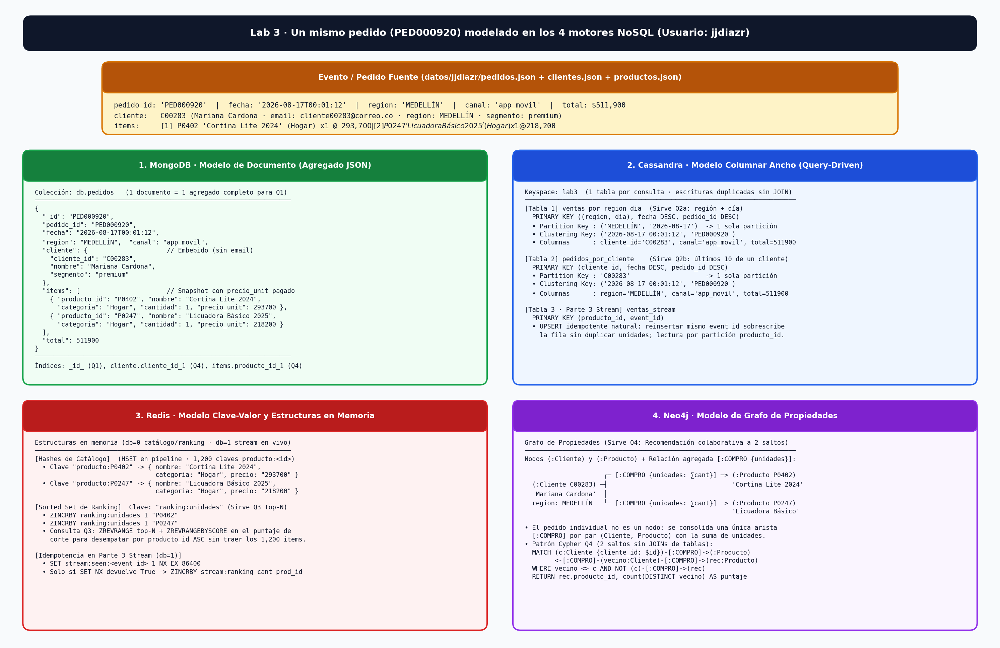

# Lab 3 · Diseño y comparativa de motores NoSQL

**Estudiante:** Juan José Díaz (`jjdiazr` · `jjdiazr@eafit.edu.co`)  
**Usuario GitHub (semilla del dataset):** `jjdiazr` (semilla `348120770`)  
**Huella de `verificar.py`:** `db92fe88da92` (`21/21 verificaciones correctas · 0 con error · 0 pendientes`)

---

## Diagrama de los modelos



> El diagrama representa el primer pedido del dataset de `jjdiazr` (`PED000920`, realizado el `2026-08-17T00:01:12` por la clienta `C00283` Mariana Cardona en la región `MEDELLÍN` por canal `app_movil`, con los ítems `P0402` *"Cortina Lite 2024"* × 1 a \$293,700 y `P0247` *"Licuadora Básico 2025"* × 1 a \$218,200, para un total de \$511,900) modelado simultáneamente en MongoDB, Cassandra, Redis y Neo4j. El archivo fuente editable se incluye en `./diagrama_modelos.drawio`.

---

## Parte 1 · Documento (MongoDB) vs. columnar ancho (Cassandra)

### 1. Diseño del documento en MongoDB (localidad vs. referencias)

- **Qué embebí del cliente y qué dejé fuera:** Dentro del subdocumento `cliente` embebí `cliente_id` (`"C00283"`), `nombre` (`"Mariana Cardona"`) y `segmento` (`"premium"`). Dejé fuera el `email` (`"cliente00283@correo.co"`) y la `region` de residencia del cliente: la consulta **Q1** únicamente proyecta `cliente_id` y `nombre` (para poder responderse en **1 sola lectura por `_id`** sin `$lookup`), y el pedido ya almacena su propia `region` de despacho en la raíz del documento. Si un cliente cambia de nombre en el futuro, actualizar todos sus pedidos históricos exigiría un `updateMany({"cliente.cliente_id": ...}, {"$set": {"cliente.nombre": ...}})` sobre los ~10 documentos promedio que tiene cada cliente (`15,000 pedidos / 1,500 clientes`), o bien aceptar que el documento del pedido conserva el nombre vigente al momento de facturar.
- **Qué embebí de cada producto y qué pasa si el precio del catálogo cambia:** En cada elemento del arreglo `items` embebí `producto_id`, `nombre`, `categoria`, `cantidad` y `precio_unit`. El campo `precio_unit` corresponde al **precio unitario efectivamente pagado en el pedido** (`pedido["items"][i]["precio_unit"]`) y **no** a una referencia viva al catálogo: en un sistema transaccional de comercio electrónico, un pedido cerrado es un documento contable inmutable; si mañana el precio de `P0402` sube en el catálogo de productos, los pedidos pasados como `PED000920` **no deben cambiar** su `precio_unit` ni su `total` (\$511,900).
- **Índices creados (`crear_indices`) y qué consultas los usan:**
  1. `_id_` (creado automáticamente por MongoDB sobre `_id = pedido_id`): resuelve **Q1** (`find_one({"_id": pedido_id})`) en tiempo $O(\log N)$ con mediana de **1.04 ms**.
  2. `cliente.cliente_id_1`: índice B-tree sobre el campo anidado `cliente.cliente_id`. Lo utiliza **Q4** en el paso 1 (obtener los productos comprados por el cliente semilla) y en el `$match` del pipeline final sobre los pedidos de los clientes vecinos.
  3. `items.producto_id_1`: índice **multikey** sobre el arreglo de subdocumentos `items.producto_id`. Lo utiliza **Q4** en el paso 2 para encontrar rápidamente todos los pedidos de clientes vecinos que compraron al menos uno de los productos del conjunto propio `P` sin escanear toda la colección (`COLLSCAN`). En cambio, **Q3** agrega el total de unidades sobre **todos** los 15,000 pedidos (`$unwind: "$items"` + `$group`), por lo que recorre la colección completa y no se beneficia de un índice selectivo.

### 2. Diseño de las tablas en Cassandra (modelado guiado por las consultas)

```sql
CREATE TABLE ventas_por_region_dia (
    region text,
    dia date,
    fecha timestamp,
    pedido_id text,
    cliente_id text,
    canal text,
    total bigint,
    PRIMARY KEY ((region, dia), fecha, pedido_id)
) WITH CLUSTERING ORDER BY (fecha DESC, pedido_id DESC);

CREATE TABLE pedidos_por_cliente (
    cliente_id text,
    fecha timestamp,
    pedido_id text,
    region text,
    canal text,
    total bigint,
    PRIMARY KEY (cliente_id, fecha, pedido_id)
) WITH CLUSTERING ORDER BY (fecha DESC, pedido_id DESC);
```

- **Por qué la partition key de `ventas_por_region_dia` es compuesta `((region, dia))` y no solo `(region)`:** La consulta **Q2a** pide las ventas de una región en una fecha específica (p. ej., `MEDELLÍN` en `2026-10-04`, que tiene **56 pedidos** y \$61,474,200 vendidos, o `MEDELLÍN` en `2026-08-17`, que tiene **72 pedidos**). Si la partition key fuera solo `(region)`, existirían apenas 5 particiones en todo el clúster (una por región) que crecerían indefinidamente día tras día (*wide partition* sin cota superior y *hotspots* de escritura/lectura en un único nodo). Al usar `((region, dia))`, cada partición agrupa exactamente los pedidos de una región en un día (~15 a 80 filas en el dataset) y **Q2a** lee **una sola partición acotada**.
- **Por qué `pedido_id` hace parte de las clustering columns además de `fecha`:** En Cassandra, la `PRIMARY KEY` completa identifica de forma única cada fila dentro de la partición. Si la llave fuera solo `((region, dia), fecha)` o `(cliente_id, fecha)`, dos pedidos que ocurran en el mismo segundo (`fecha` con resolución de segundos) colisionarían en la misma llave primaria y el segundo `INSERT` **sobrescribiría silenciosamente** al primero. Incluir `pedido_id` como última columna de clustering garantiza unicidad y orden determinista (`WITH CLUSTERING ORDER BY (fecha DESC, pedido_id DESC)`).
- **Por qué el mismo pedido se escribe dos veces (15,000 filas en `ventas_por_region_dia` + 15,000 filas en `pedidos_por_cliente`) y cuál es el costo:** Cassandra no soporta `JOIN` entre tablas ni permite filtrar eficientemente por columnas fuera de la partition key sin escanear todos los nodos (`ALLOW FILTERING`). Como **Q2a** busca por `(region, dia)` y **Q2b** busca por `cliente_id`, el principio de *query-driven modeling* exige una tabla física por patrón de acceso. El costo es duplicar el almacenamiento en disco y el tráfico de escritura (30,000 inserciones para 15,000 pedidos, que tomaron **27.2 s** con concurrencia 64), además de la responsabilidad en la aplicación de mantener ambas tablas consistentes al escribir.

---

## Parte 2 · Clave-valor (Redis) y grafo (Neo4j)

### 3. Q3 · Top 10 de productos: MongoDB vs. Redis

| Motor | Mediana (ms) | Qué hace la consulta por dentro |
|---|---:|---|
| MongoDB | 64.22 ms | Recorre los 15,000 documentos de `pedidos`, desanida ~30,000 ítems con `$unwind: "$items"`, calcula la suma por `producto_id` en memoria con `$group`, ordena 1,200 productos con `$sort` y toma 10 con `$limit`. |
| Redis | 0.58 ms | Lee en memoria el *sorted set* precalculado `ranking:unidades` (skip list + tabla hash): obtiene el top 10 con `ZREVRANGE` ($O(\log N + 10)$) y resuelve empates en el puntaje de corte con `ZREVRANGEBYSCORE`. |

- **Por qué Redis es ~110× más rápido en la lectura y cuándo se paga ese trabajo:** En MongoDB el ranking se calcula **al leer** (*compute-on-read*): cada vez que alguien ejecuta Q3 se procesan los 15,000 documentos (`64.22 ms`). En Redis el trabajo se paga **al escribir** (*compute-on-write*): cada ítem vendido incrementa atómicamente el puntaje del producto mediante `ZINCRBY ranking:unidades <cantidad> <producto_id>` (manteniendo ordenado el *skip list* en $O(\log M)$ con $M = 1{,}200$ productos). Así, consultar el top 10 (`P0547` con 617 unidades, `P0104` con 424, `P1112` con 314, ..., `P0949` con 124) toma apenas **0.58 ms**.
- **Qué consulta NO puede responder ese sorted set de Redis (que MongoDB o Cassandra sí pueden):** `ranking:unidades` solo conserva el acumulado global histórico por `producto_id`. **No puede** responder *"¿cuál fue el top 10 de productos vendidos en la región MEDELLÍN durante agosto de 2026?"* ni *"¿cuántas unidades compró el segmento premium por canal app_movil?"*, porque al agregar en un único *sorted set* se descartaron las dimensiones de fecha, región, cliente y canal (en MongoDB están en cada documento; si quisiéramos eso en Redis tendríamos que haber creado una clave `ranking:<region>:<mes>` de antemano).

### 4. Q4 · Recomendaciones: MongoDB vs. Neo4j

| Cliente | Mediana MongoDB (ms) | Mediana Neo4j (ms) | Top-5 recomendado |
|---|---:|---:|---|
| `C00146` | 70.24 ms | 89.51 ms | `[('P0547', 83), ('P1112', 53), ('P0194', 41), ('P0158', 40), ('P0340', 40)]` |
| `C00438` | 103.63 ms | 41.16 ms | `[('P0547', 64), ('P0104', 61), ('P0817', 47), ('P1112', 45), ('P0340', 35)]` |
| `C00363` | 171.80 ms | 33.45 ms | `[('P0547', 129), ('P0104', 73), ('P1112', 43), ('P0817', 42), ('P0602', 39)]` |

- **Comparación de las dos implementaciones (claridad, pasos y tiempos):**
  - En **MongoDB**, atravesar una relación muchos-a-muchos de 2 saltos (*Cliente → Productos propios → Clientes vecinos → Productos candidatos*) obliga a romper la consulta en **3 viajes a la base de datos**: (1) `distinct("items.producto_id")` para hallar los productos propios `P` del cliente; (2) `distinct("cliente.cliente_id")` usando el índice multikey `items.producto_id_1` para hallar los vecinos; y (3) un pipeline con `$match`, `$unwind`, `$match` (`$nin`), `$group` (`$addToSet`) y `$project` (`$size`). A medida que el cliente tiene más compras y más vecinos (como `C00363`, cuyo producto top `P0547` fue comprado por 129 vecinos), el pipeline de MongoDB tiene que desanidar muchos más documentos y la mediana sube hasta **171.80 ms**.
  - En **Neo4j**, el grafo almacena `2,700` nodos (`1,500` `:Cliente` + `1,200` `:Producto`) y `27,775` relaciones `[:COMPRO]`. Gracias a la *index-free adjacency* (cada nodo apunta directamente a sus aristas entrantes y salientes), toda la recomendación se expresa de forma declarativa en una sola consulta Cypher de 8 líneas (`MATCH (c:Cliente)-[:COMPRO]->(:Producto)<-[:COMPRO]-(vecino:Cliente) ... MATCH (vecino)-[:COMPRO]->(rec:Producto) WHERE NOT (c)-[:COMPRO]->(rec)`). En caliente (`C00438` y `C00363`), Neo4j resuelve el recorrido en **41.16 ms** y **33.45 ms** (**~5.1× más rápido** que MongoDB en `C00363`, el caso con mayor grado de vecindad).
- **Si la recomendación fuera a 3 saltos ("amigos de los que compraron lo mismo que tú"), qué pasaría en cada motor:** En **Neo4j** bastaría con añadir un patrón adicional en el `MATCH` (`(c)-[:COMPRO]->()<-[:COMPRO]-(v1)-[:COMPRO]->()<-[:COMPRO]-(v2)-[:COMPRO]->(rec)`), manteniendo recorridos locales de punteros en memoria. En **MongoDB**, un tercer salto implicaría otro viaje de red o un `$lookup` recursivo (`$graphLookup`) con explosión combinatoria de arreglos intermedios y `$unwind`, degradando drásticamente la latencia y el consumo de RAM.

---

## Parte 3 · Ingesta de un stream con reentregas

### 5.Resultados del stream

- **Entregas procesadas vs. eventos únicos:** El archivo `eventos_stream.json` contiene `6,000` eventos (5,000 únicos + 1,000 reentregas ya presentes en la fuente). Además, la caída simulada del consumidor en la posición `3,700` (con `COMMIT_CADA = 500`, último commit en `3,500`) reentregó otros `200` eventos. En total se procesaron **`6,200` entregas** correspondientes a **`5,000` eventos únicos** (`1,200` duplicados en total).
- **Unidades reales vs. las que contó el sink ingenuo de Redis:** Las unidades reales vendidas en los 5,000 eventos únicos son **`7,021`**. El sink ingenuo (`ZINCRBY` directo sobre cada entrega) contó **`8,722` unidades** (**`+1,701` unidades de más**, una sobreestimación del **24.2%**). Tanto el sink idempotente de Redis (`TODO 1`) como la tabla de Cassandra (`TODO 2-3`) contaron exactamente **`7,021` unidades**.

### 6. Idempotencia en Redis (`sink_redis`)

- **Cómo se garantiza que cada `event_id` sume una sola vez:** Antes de incrementar el ranking, `sink_redis` ejecuta:
  ```python
  if r.set(f"stream:seen:{evento['event_id']}", 1, nx=True, ex=86400):
      r.zincrby(CLAVE_RANKING, int(evento["cantidad"]), evento["producto_id"])
  ```
  El modificador `NX` (*Not Exists*) de Redis es atómico: la clave `stream:seen:<event_id>` solo se crea y devuelve `True` la **primera vez** que se ve ese `event_id`. En cualquier reentrega posterior del mismo `event_id`, `SET ... NX` devuelve `None`/`False` y el `ZINCRBY` no se ejecuta.
- **Cómo evitar en producción que la estructura de eventos vistos crezca sin límite:** Se asigna un **TTL (*Time-To-Live*) con `ex=86400`** (24 horas, o una ventana ligeramente mayor que el máximo retraso esperado de reentrega/reprocesamiento del broker de streaming). Así Redis expira y libera automáticamente de la RAM las claves `stream:seen:*` antiguas sin intervención manual.
- **¿Sigue siendo correcta si dos consumidores procesan el mismo `event_id` al mismo tiempo?**
  - Respecto a la **condición de carrera entre dos consumidores vivos**, como Redis ejecuta comandos en un único hilo de ejecución (*single-threaded event loop*), si dos consumidores envían `SET stream:seen:<id> 1 NX EX 86400` simultáneamente, Redis serializa ambos comandos: exactamente **uno** recibirá `True` y ejecutará `ZINCRBY`, y el otro recibirá `None`.
  - **Sin embargo**, como `SET ... NX` y `ZINCRBY` son **dos comandos separados**, si el proceso consumidor que ganó el `SET NX` **se cae justo entre el `SET` y el `ZINCRBY`**, la clave `stream:seen:<id>` ya habrá quedado marcada en Redis pero el puntaje nunca se habrá sumado (pérdida del incremento en el reintento). Para que sea 100% atómico ante fallos a mitad de camino o concurrencia en producción, ambos pasos deben ejecutarse dentro de un **script Lua** en el servidor (`EVAL`: verificar/escribir `SET NX` y hacer `ZINCRBY` en una sola operación indivisible de Redis).

### 7. Idempotencia en Cassandra (`ventas_stream`)

```sql
CREATE TABLE ventas_stream (
    producto_id text,
    event_id text,
    cantidad int,
    ts text,
    PRIMARY KEY (producto_id, event_id)
);
```

- **Por qué escribir el mismo evento dos veces en esta tabla no duplica las unidades:** En el motor de almacenamiento de Cassandra (Memtable + SSTables), toda escritura `INSERT` es semánticamente un **`UPSERT` identificado por la `PRIMARY KEY`**. Al definir `PRIMARY KEY (producto_id, event_id)`:
  1. `producto_id` actúa como **partition key**, agrupando en una misma partición todos los eventos de venta de un producto (lo que permite a `unidades_por_producto_cassandra` consultar cada producto con `WHERE producto_id = ?` sin `ALLOW FILTERING`).
  2. `event_id` actúa como **clustering column**, identificando cada evento único dentro de la partición de ese producto. Cuando un evento duplicado llega por segunda o tercera vez con el mismo `(producto_id, event_id)`, Cassandra sobrescribe exactamente la misma celda `(producto_id, event_id) -> cantidad` con el mismo valor `cantidad`, dejando la suma por partición en **`7,021` unidades** sin necesidad de leer antes de escribir (*read-before-write*).
  3. **Contraste con contadores de Cassandra (`COUNTER`):** Si hubiéramos usado una columna tipo `COUNTER` (`UPDATE ... SET unidades = unidades + ?`), la operación **no sería idempotente** ante reentregas at-least-once (sufriría el mismo problema de `+1,701` unidades extra que el `ZINCRBY` ingenuo).Guardar el registro por `event_id` convierte una suma no idempotente en una escritura idempotente por llave primaria.

---

## Síntesis · Tabla de decisión

| Consulta / caso | Motor elegido | Segundo mejor | Motor que NO usaría y por qué |
|---|---|---|---|
| **Q1** · Pedido completo por `pedido_id` | **MongoDB** (`1.04 ms` en 1 lectura por `_id` con cliente e ítems embebidos) | **Redis** (guardando el JSON serializado en una clave `pedido:<id>`, aunque consume más RAM) | **Neo4j**: reconstruir el documento contable de un pedido con sus líneas, precios unitarios y datos del cliente exige recorrer múltiples nodos y aristas cuando en realidad se pide un único agregado autocontenido. |
| **Q2a** · Ventas de una región en un día | **Cassandra** (`16.42–20.92 ms` leyendo una sola partición `(region, dia)` ordenada por `fecha DESC`) | **MongoDB** (con un índice compuesto `{region: 1, fecha: -1}`) | **Redis**: al no tener consultas por rangos compuestos ad hoc, obligaría a mantener manualmente un *sorted set* o índice secundario por cada combinación `(región, día)`. |
| **Q2b** · Últimos 10 pedidos de un cliente | **Cassandra** (`11.03–19.99 ms` leyendo las primeras 10 filas físicas de la partición `cliente_id` con `LIMIT 10`) | **MongoDB** (usando un índice compuesto `{ "cliente.cliente_id": 1, "fecha": -1 }`) | **Neo4j** (con el modelo agregado `[:COMPRO]`): el grafo consolidó las compras por par `(Cliente, Producto)` y ni siquiera conserva los pedidos individuales ni sus fechas. |
| **Q3** · Top 10 de productos en vivo | **Redis** (`0.58 ms` con `ZREVRANGE` sobre un *sorted set* actualizado en tiempo de escritura con `ZINCRBY`) | **MongoDB** (`64.22 ms` con pipeline `$unwind` + `$group`, aceptable para reportes batch pero >100× más lento en vivo) | **Cassandra**: agregar el total global de unidades de todos los productos y ordenarlos de mayor a menor por una columna que no es llave primaria es un antipatrón en Cassandra (requeriría leer todas las particiones y ordenar en la aplicación). |
| **Q4** · Recomendaciones ("clientes como tú") | **Neo4j** (`33.45–89.51 ms`, expresado naturalmente en 1 consulta Cypher de 2 saltos sobre `[:COMPRO]`) | **MongoDB** (`70.24–171.80 ms` combinando 2 consultas `distinct` + 1 pipeline con índices multikey) | **Cassandra**: resolver una relación muchos-a-muchos de 2 saltos sin `JOIN` obligaría a ejecutar decenas o cientos de consultas en cascada desde Python (*client-side joins*). |
| **Parte 3** · Stream con reentregas (ranking en vivo) | **Redis (`SET NX EX` + `ZINCRBY` / Lua) + Cassandra (`PRIMARY KEY (producto_id, event_id)`)** | **MongoDB** (usando `update_one({"_id": event_id}, {"$setOnInsert": ...}, upsert=True)`) | **Contadores no deduplicados (`ZINCRBY` directo en Redis o `COUNTER` en Cassandra)**: bajo entrega *at-least-once* suman cada reintento y sobreestiman las ventas (`8,722` vs. `7,021` reales). |

### 8. Pregunta de cierre: poliglotismo vs. complejidad operativa

Si este comercio electrónico fuera un sistema real de una empresa mediana en Colombia con un equipo de **tres ingenieros**, **no montaría los cuatro motores en producción desde el día uno**. Operar cuatro bases de datos distintas (MongoDB, Cassandra, Redis y Neo4j) para un equipo de 3 personas implicaría multiplicar por cuatro el esfuerzo de monitoreo, copias de seguridad (*backups*), control de acceso, parches de seguridad, manejo de fallos y sincronización de escrituras entre motores (lo que en la práctica garantiza inconsistencias cuando una escritura triunfa en un motor y falla en otro).

Elegiría únicamente **dos motores: MongoDB + Redis**:
1. **MongoDB como base de datos primaria (*system of record*):**
   - Resuelve **Q1** de forma nativa en ~1 ms leyendo el agregado del pedido por `_id`.
   - Resuelve **Q2a** y **Q2b** en pocos milisegundos simplemente añadiendo dos índices compuestos B-tree: `{region: 1, fecha: -1}` y `{"cliente.cliente_id": 1, fecha: -1}`, eliminando por completo la necesidad de mantener un clúster de Cassandra y duplicar tablas para un volumen de una empresa mediana.
   - Resuelve **Q4** (recomendaciones) en `70–172 ms` mediante el índice multikey `items.producto_id_1` y `cliente.cliente_id_1`.
2. **Redis como capa en memoria de baja latencia y deduplicación de streaming:**
   - Resuelve **Q3** (ranking Top-N en vivo) en `0.58 ms` y absorbe la deduplicación de eventos del stream en tiempo real con `SET ... NX EX` + `ZINCRBY` (o script Lua), además de servir como caché de sesiones y catálogo.

- **Qué consulta quedaría menos cómoda y cómo mitigarla:** La consulta que sacrificaríamos en elegancia y latencia frente a un motor especializado es **Q4 (recomendaciones colaborativas)**, que en MongoDB toma hasta `171.80 ms` (frente a `33.45 ms` en Neo4j para clientes muy conectados) y requiere tres pasos. Para mitigar ese costo sin introducir Neo4j en producción, **precalcularíamos las recomendaciones en segundo plano** (por ejemplo, recalculando cada hora o tras cada compra el top-5 de productos recomendados del cliente y guardándolo en Redis bajo la clave `reco:cliente:<cliente_id>` con un TTL de 1 hora, o en un campo embebido del documento del cliente en MongoDB).
