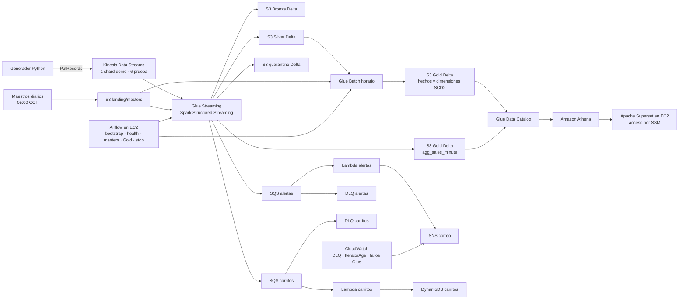

# Arquitectura final implementada · TiendaCol E2

CloudFormation despliega los recursos de la región `us-east-1` y un presupuesto con alertas. S3 y Kinesis usan KMS administrado por AWS; SQS usa SSE administrado por SQS. Las dos EC2 tienen roles IAM separados y no admiten tráfico entrante. El acceso a Airflow y Superset se hace mediante Session Manager.

Cada tabla Gold tiene un único escritor. Glue Streaming escribe `agg_sales_minute` para el límite de latencia de RF-09; Glue Batch escribe las dimensiones y demás tablas de hechos. Esta es la modificación respecto a la frase «Gold tiene un único escritor: AWS Glue Batch» del [diagrama de diseño](<../../TiendaCol_Arquitectura_AWS_2026.drawio (1).pdf>).

`tiendacol_stop_demo` detiene Glue Streaming. `stop_costs.py` detiene ambas EC2 y los jobs; `destroy_demo.py` elimina el stack y el stream Kinesis cuando termine la evaluación. Los buckets S3 se conservan por `DeletionPolicy: Retain`.
