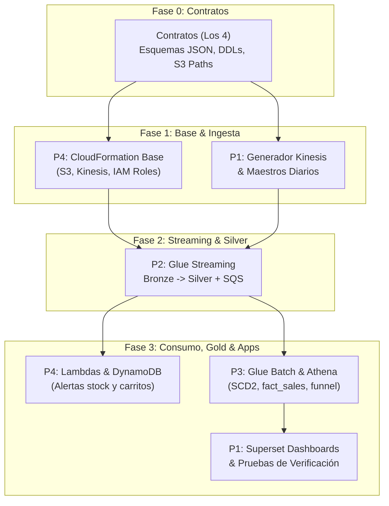

# Reparto de trabajo — TiendaCol en tiempo real (E2)

**ST1630 · Sistemas Intensivos en Datos** · Semestre 2026-2  
Universidad EAFIT · Escuela de Ciencias Aplicadas e Ingeniería  
Profesor: Andrés Sacre Alzate  

---

## 1. Contexto y Cambios Frente al Entregable 1 (E1)

Con la arquitectura aprobada, el reparto del E1 se actualizó: cambian los componentes y cambia quién escribe Silver. El proyecto se divide en cuatro frentes, uno por integrante, con un bloque previo de contratos que hacemos los cuatro juntos (Fase 0).

### Principales cambios arquitectónicos:
- **Kafka $\rightarrow$ Kinesis Data Streams:** 1 shard en la demo, 6 en la prueba de estrés de 5.000 ev/s (RNF-01).
- **Spark en EC2 $\rightarrow$ AWS Glue:** Glue Streaming para tiempo real y Glue Batch para el procesamiento horario.
- **La EC2 solo corre Airflow:** Es el plano de control: arranca, supervisa y detiene los jobs de Glue por API. No ejecuta Kafka ni Spark localmente.
- **Nuevos componentes administrados:** SQS con una DLQ por caso de uso, AWS Lambda para alertas y carritos, CloudWatch, KMS, AWS Budgets y CloudFormation (IaC).
- **Silver lo escribe Glue Streaming, no el batch:** Por esta razón, **RF-05 y RF-06 pasan de P3 a P2**.
- **Gold tiene un único escritor (Glue Batch):** Con la excepción a definir de `agg_sales_minute`.

---

## 2. Reparto de Responsabilidades por Integrante

Cada Requisito Funcional (RF) tiene un responsable asignado, salvo el **RF-08**, que se reparte entre **P2** (detección en streaming) y **P4** (publicación en DynamoDB).

| Integrante | Rol | Qué implementa | Requisitos Cubiertos |
| :--- | :---: | :--- | :--- |
| **Juan Simón Ospina** | **P1** | Generador Python (`boto3 PutRecords` a Kinesis) con duplicados, eventos tardíos y rampa de carga hasta 5.000 ev/s. Maestros diarios (catálogo, clientes, vendedores) hacia `landing/masters/`. Tableros de Superset. Pruebas de la columna *"Cómo se verifica"* de todos los RF. | **RF-04** · Pruebas de todos los RF |
| **Sebastián Durán** | **P2** | Streams de Kinesis y Glue Streaming: Bronze en append, validación, cuarentena, deduplicación y enriquecimiento hacia Silver. Stock como estado, ventana de 15 min (**RF-07**), sesión de 30 min (**RF-08**) y agregado por minuto (**RF-09**). Publica los eventos de decisión en SQS. | **RF-01, RF-02, RF-03, RF-05, RF-06, RF-07, RF-08, RF-09** |
| **Juan José Díaz Rodríguez** | **P3** | **AWS Glue Batch horario:** dimensiones con historial de cambios (**SCD Tipo 2**), tablas de hechos `fact_sales` y `fact_funnel_event`, métricas de embudo de conversión y ventas. Registro de tablas en AWS Glue Data Catalog y consultas analíticas en Amazon Athena. | **RF-10, RF-11** · *(RF-13 opcional si hay tiempo)* |
| **Daniel Arcila Salazar** | **P4** | **Infraestructura como Código (IaC):** CloudFormation (S3, Kinesis, Glue, SQS + DLQ, SNS, DynamoDB, IAM, KMS, CloudWatch, Budgets). Funciones Lambda para alertas y carritos. Airflow en EC2 con los DAGs de bootstrap, health, maestros, horario y stop demo. `README.md`, bitácora consolidada de IA, PR y control de costos. | **RF-12** · Publicación de **RF-08** |

> **Balance de carga:** P2 asume la carga más pesada de streaming y P3 la lógica analítica y dimensional de Gold. P1 compensa con la suite de pruebas y apoya a P2 en RF-08 y RF-09. P4 garantiza la infraestructura automatizada, la orquestación y el control estricto de presupuesto.

---

## 3. Dependencias entre Integrantes



- **P4 bloquea a todos al inicio:** Sin el stack base de CloudFormation (S3, Kinesis, IAM), nadie puede probar en AWS; mientras tanto, el resto avanza en local con archivos y mocks.
- **P2 es el cuello de botella central:** Su capa Silver alimenta a P3 (Gold) y sus eventos de decisión en SQS alimentan las Lambdas de P4. Debe entregar pronto una versión mínima de Silver.
- **P1 es independiente al inicio pero crítico al final:** Sus pruebas deciden si los RF pasan o no. Sus maestros diarios alimentan el enriquecimiento de P2 y las dimensiones de P3.
- **P3 arranca con datos sintéticos:** Construye la lógica de Gold y se conecta al Silver real una vez P2 lo tenga listo.
- **P4 con Airflow arranca y supervisa:** Orquesta los jobs de Glue de P2 y P3.

---

## 4. Orden de Trabajo por Fases

1. **Fase 0 · Contratos (Primeros 2–3 días, los 4 juntos):**
   - JSON de cada evento (`clickstream`, `orders`, `stock_changes`) con `event_id`.
   - Rutas definitivas en S3 (`bronze/`, `silver/`, `quarantine/`, `gold/`, `landing/masters/`).
   - DDLs de tablas en Silver y Gold.
   - Formato de mensajes de SQS (`alert_id`, y `user_id` más valor del carrito).
2. **Fase 1 · Esqueleto de punta a punta:**
   - Un evento del generador viaja por Kinesis hasta Bronze en S3.
   - P4 valida primero qué servicios permite el Learner Lab (Glue, Lambda, SQS, DynamoDB, CloudFormation).
3. **Fase 2 · Lógica de negocio:**
   - P2 construye streaming y Silver.
   - P3 construye Gold con datos sintéticos.
   - P4 construye las Lambdas y los DAGs de Airflow.
   - P1 prepara las pruebas de RF-01 a RF-09.
4. **Fase 3 · Integración:**
   - Gold corre sobre el Silver real.
   - Consultas en Athena, tableros en Superset, `README` y DAGs completos.
   - Verificación cruzada: un integrante que no escribió el código levanta el flujo desde cero.
5. **Fase 4 · Demo y defensa:**
   - Ensayo completo el día anterior y simulacro de preguntas cruzadas.

---

## 6. Estructura del Directorio `entregable2`

```
proyecto-final/entregable2/
├── README.md                  ← Este documento general
├── p1-generador/              ← Generador Kinesis, maestros, Superset y tests (Juan Simón Ospina)
├── p2-streaming/              ← Kinesis, Glue Streaming, Bronze y Silver (Sebastián Durán)
├── p3-gold-batch/             ← Glue Batch, SCD2, fact tables y Athena (Juan José Díaz)
└── p4-infra-orquestacion/     ← CloudFormation, Lambdas, Airflow y DynamoDB (Daniel Arcila)
```

---

## 7. Despliegue y demo en AWS

P4 implementó el stack y los DAGs en [`p4-infra-orquestacion/`](p4-infra-orquestacion/README.md). El despliegue reproduce S3, Kinesis, Glue Streaming y Batch, SQS con DLQ, SNS, DynamoDB, IAM, Athena, CloudWatch, Budgets y una EC2 dedicada a Airflow.

```powershell
# Desde proyecto-final; requiere entregable2/.env completo y cuenta AWS Paid con créditos.
python entregable2/p4-infra-orquestacion/deploy.py
python entregable2/p4-infra-orquestacion/verify.py --ssm
```

Confirmar el correo de SNS. En Airflow, ejecutar `tiendacol_bootstrap` para cargar maestros y arrancar Glue Streaming. Después de que el job esté en `RUNNING`, enviar eventos con P1 usando los mismos parámetros que los maestros del DAG:

```powershell
python entregable2/p4-infra-orquestacion/run_generator.py run --sink kinesis --stream tiendacol-events --region us-east-1 --seed 1630 --products 1000 --customers 2000 --rate 20 --duration 30
python entregable2/p4-infra-orquestacion/run_generator.py scenario rf13 --sink kinesis --stream tiendacol-events --region us-east-1 --seed 1630 --products 1000 --customers 2000 --fast
```

El DAG `tiendacol_gold_hourly` ejecuta Glue Batch y registra las tablas Delta en Athena. Para terminar la sesión, ejecutar `tiendacol_stop_demo` y detener la EC2 si no se seguirá usando Airflow. Ver el [manual de P4](p4-infra-orquestacion/README.md) para las salidas del stack, la consulta SQL, control de costos y la desviación de cifrado KMS observada en la cuenta nueva.
